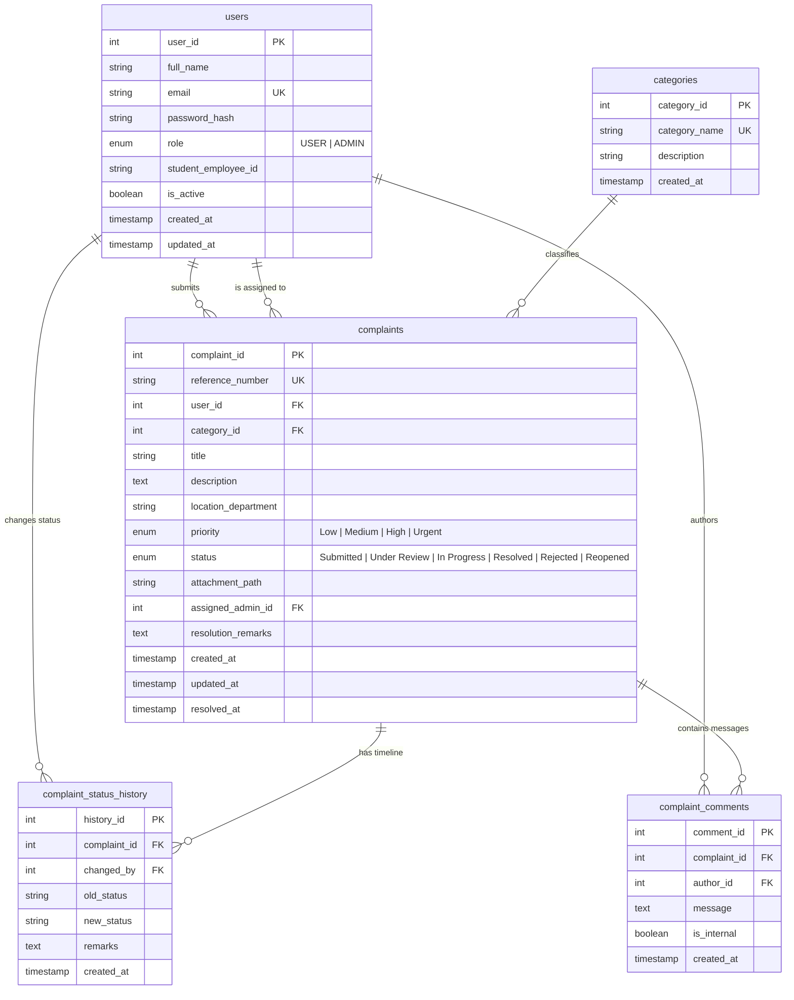
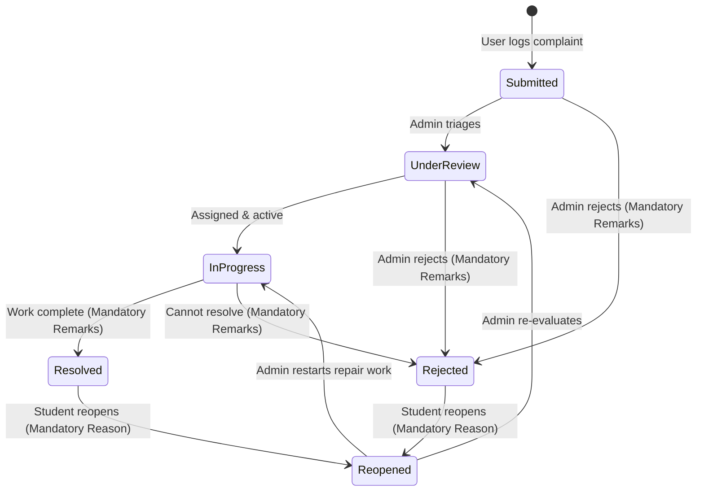

# Online Complaint Management System (OCMS)

> A modern, production-grade campus grievance and complaint redressal portal engineered for colleges and universities.

OCMS provides an end-to-end full-stack platform where students and faculty can lodge facility, academic, hostel, and IT complaints, track them in real time using unique reference identifiers (e.g. `OCMS-2026-00001`), and monitor complete audit trails. Administrators receive a centralized dashboard with live database analytics, triage queues, technician assignment, mandatory resolution remarks, and CSV reporting.

---

## Table of Contents

1. [Features Breakdown](#features-breakdown)
2. [Technology Stack](#technology-stack)
3. [Architecture and Project Structure](#architecture-and-project-structure)
4. [Database Design & Mermaid ER Diagram](#database-design--mermaid-er-diagram)
5. [Complaint Lifecycle Workflow State Machine](#complaint-lifecycle-workflow-state-machine)
6. [Prerequisites & System Setup](#prerequisites--system-setup)
7. [Environment Configuration](#environment-configuration)
8. [Database Initialization & Seeding](#database-initialization--seeding)
9. [Starting the Application](#starting-the-application)
10. [Demo Credentials](#demo-credentials)
11. [REST API Documentation](#rest-api-documentation)
12. [Automated Testing & Results](#automated-testing--results)
13. [Troubleshooting & Common Errors](#troubleshooting--common-errors)
14. [Security & Production Considerations](#security--production-considerations)

---

## Features Breakdown

### For Students and Faculty (`USER` Role)
- **Account Registration & Security**: Enforces unique college email, strong passwords (8+ chars, upper, lower, digit, special character), and optional student/employee identification number.
- **Interactive Dashboard**: Real-time counter of submitted, in-progress, resolved, and reopened tickets, with quick submit links.
- **Complaint Submission**:
  - Automatically generates an immutable, sequential ticket ID (e.g. `OCMS-2026-00001`).
  - Categorization into 9 standardized campus sectors.
  - Priority selection (`Low`, `Medium`, `High`, `Urgent`).
  - Department and physical classroom/hall location targeting.
  - Optional photo or PDF attachment upload (up to 5MB) with sanitized filenames and MIME-type validation.
- **Ticket Tracking**: Search by reference number or title; filter by category, status, priority, and date range; sort results and navigate with pagination.
- **Audit Timeline**: View immutable timestamps, technician notes, and status transition logs.
- **Two-Way Discussion Thread**: Converse with campus administrators directly on the ticket.
- **Ticket Reopening**: Allows complaint owners to reopen any `Resolved` or `Rejected` complaint if the issue recurs or was not adequately fixed.
- **Profile Management**: Update personal name, student/staff ID, or update account password.

### For Administrators (`ADMIN` Role)
- **SQL-Driven Analytics Dashboard**:
  - Total tickets logged, counts by status, and overall resolution rate (%).
  - Categorical distribution chart via Recharts.
  - Complaints by status and urgency priority level.
  - Real-time recent ticket triage queue.
- **Comprehensive Complaint Queue**:
  - Multi-parameter filter across reference number, student name, email, department, status, and assignee.
  - Single-click CSV report export with customized filtering.
- **Administrative Triage Operations**:
  - Assign complaints to specific administrators or estate officers.
  - Dynamically modify priority levels.
  - Update complaint status strictly complying with the defined state machine (`Submitted` → `Under Review` → `In Progress` → `Resolved` / `Rejected`).
  - Enforced mandatory remarks when resolving or rejecting tickets.
- **Internal Staff Notes**: Post private internal notes on complaints that are completely invisible to regular students.
- **User Directory**: View registered campus accounts, see complaints count per user, and deactivate or reactivate accounts (with safeguard against self-deactivation).

---

## Technology Stack

| Layer | Technology | Version | Purpose |
| :--- | :--- | :--- | :--- |
| **Frontend** | React | `^18.3.1` | Declarative UI component tree |
| | Vite | `^6.0.3` | Ultra-fast bundling, HMR, and dev server |
| | React Router | `^6.28.0` | Client-side routing with role-based route guards |
| | Tailwind CSS | `^3.4.16` | Responsive styling and custom navy/blue design system |
| | Lucide React | `^0.468.0` | Modern, clean iconography |
| | Recharts | `^2.15.0` | Visual charts for admin metrics |
| | Axios | `^1.7.9` | Centralized HTTP client with interceptors |
| **Backend** | Node.js | `v24.x` / `v20.x` | High-performance JavaScript runtime |
| | Express | `^4.21.2` | RESTful API server framework |
| | MySQL2 | `^3.12.0` | Connection pool & parameterized SQL queries |
| | JWT (`jsonwebtoken`) | `^9.0.2` | Stateless bearer token authentication |
| | Bcryptjs | `^2.4.3` | Salted password hashing (salt rounds: 10) |
| | Multer | `^1.4.5` | Secure multipart file upload handling |
| | Helmet | `^8.0.0` | HTTP security response headers |
| | Express Rate Limit | `^7.5.0` | Brute-force protection on auth endpoints |
| **Database** | MySQL | `8.0+` | Relational DBMS named `ocms_db` |
| **Testing** | Jest + Supertest | `^29.7.0` | Backend end-to-end API integration tests |
| | Vitest + RTL | `^2.1.8` | Frontend component unit & behavior tests |

---

## Architecture and Project Structure

```
OCMS/
├── client/                     # Vite + React Frontend
│   ├── src/
│   │   ├── components/         # Reusable UI components (Badges, Cards, Modals, Tables)
│   │   ├── context/            # AuthContext, ToastContext
│   │   ├── hooks/              # useAuth, useToast custom hooks
│   │   ├── layouts/            # PublicLayout, DashboardLayout (with responsive sidebar)
│   │   ├── pages/              # 12+ Pages (Landing, Auth, Dashboards, Complaint detail, etc.)
│   │   ├── services/           # api.js, authService, complaintService, adminService
│   │   ├── test/               # Vitest component test suites
│   │   └── utils/              # Date formatters, badge color helpers
│   ├── index.html              # HTML template with Inter typography
│   ├── package.json
│   ├── tailwind.config.js      # Custom navy & primary blue color schemes
│   └── vite.config.js          # Proxy configuration to port 5001
├── server/                     # Express Node.js Backend
│   ├── src/
│   │   ├── config/             # Database pool connection (db.js)
│   │   ├── controllers/        # authController, complaintController, adminController
│   │   ├── middleware/         # authMiddleware, roleMiddleware, uploadMiddleware, errorHandler
│   │   ├── routes/             # authRoutes, complaintRoutes, adminRoutes
│   │   ├── services/           # complaintService (atomic ref generation & status history)
│   │   ├── validators/         # authValidator, complaintValidator
│   │   ├── app.js              # Express app middleware and route bindings
│   │   └── server.js           # Server startup and database ping
│   ├── tests/                  # Supertest integration test suite
│   ├── .env.example
│   └── package.json
├── database/                   # Database scripts
│   ├── schema.sql              # Normalized DDL schema definitions
│   └── seed.sql                # Categories, demo users, and 12 sample complaints
├── uploads/                    # Local directory for uploaded photos and PDFs
├── .env.example                # Project root environment template
├── .gitignore                  # Git exclusions (.env, node_modules, uploads)
├── package.json                # Root convenience scripts (start, test, dev)
└── README.md                   # Full documentation
```

---

## Database Design & Mermaid ER Diagram

The database `ocms_db` is normalized to **Third Normal Form (3NF)**:
1. **1NF**: Every column contains atomic scalar values (no multivalued or composite attributes).
2. **2NF**: All non-key attributes are fully functionally dependent on the entire primary key.
3. **3NF**: There are no transitive dependencies; non-primary attributes depend strictly on candidate keys.

### Tables Specification

- **`users`**:
  - `user_id` (PK, INT AUTO_INCREMENT)
  - `full_name` (VARCHAR 150)
  - `email` (VARCHAR 150, UNIQUE)
  - `password_hash` (VARCHAR 255)
  - `role` (ENUM: `'USER'`, `'ADMIN'`)
  - `student_employee_id` (VARCHAR 50, Nullable)
  - `is_active` (BOOLEAN, Default TRUE)
  - `created_at`, `updated_at` (TIMESTAMP)

- **`categories`**:
  - `category_id` (PK, INT AUTO_INCREMENT)
  - `category_name` (VARCHAR 100, UNIQUE)
  - `description` (VARCHAR 255)
  - `created_at` (TIMESTAMP)

- **`complaints`**:
  - `complaint_id` (PK, INT AUTO_INCREMENT)
  - `reference_number` (VARCHAR 30, UNIQUE) — e.g., `OCMS-2026-00001`
  - `user_id` (FK to `users.user_id` ON DELETE CASCADE)
  - `category_id` (FK to `categories.category_id` ON DELETE RESTRICT)
  - `title` (VARCHAR 200)
  - `description` (TEXT)
  - `location_department` (VARCHAR 150)
  - `priority` (ENUM: `'Low'`, `'Medium'`, `'High'`, `'Urgent'`)
  - `status` (ENUM: `'Submitted'`, `'Under Review'`, `'In Progress'`, `'Resolved'`, `'Rejected'`, `'Reopened'`)
  - `attachment_path` (VARCHAR 255, Nullable)
  - `assigned_admin_id` (FK to `users.user_id` ON DELETE SET NULL)
  - `resolution_remarks` (TEXT, Nullable)
  - `created_at`, `updated_at`, `resolved_at` (TIMESTAMP)

- **`complaint_status_history`**:
  - `history_id` (PK, INT AUTO_INCREMENT)
  - `complaint_id` (FK to `complaints.complaint_id` ON DELETE CASCADE)
  - `changed_by` (FK to `users.user_id` ON DELETE CASCADE)
  - `old_status` (VARCHAR 50, Nullable)
  - `new_status` (VARCHAR 50)
  - `remarks` (TEXT, Nullable)
  - `created_at` (TIMESTAMP)

- **`complaint_comments`**:
  - `comment_id` (PK, INT AUTO_INCREMENT)
  - `complaint_id` (FK to `complaints.complaint_id` ON DELETE CASCADE)
  - `author_id` (FK to `users.user_id` ON DELETE CASCADE)
  - `message` (TEXT)
  - `is_internal` (BOOLEAN, Default FALSE) — true indicates staff-only note
  - `created_at` (TIMESTAMP)



---

## Complaint Lifecycle Workflow State Machine

The complaint resolution process follows a strict state transition matrix enforced on the server inside MySQL transactions:



1. **User Submission**: Ticket is created with status `Submitted`. Reference number `OCMS-YYYY-XXXXX` is locked and generated sequentially.
2. **Administrative Triage**: Admin inspects report, assigns officer, and shifts ticket to `Under Review`.
3. **Action in Field**: Transition to `In Progress`. Plumber, electrician, or IT engineer performs the work.
4. **Resolution**: Admin marks as `Resolved` (setting `resolved_at = NOW()`) with **mandatory remarks**.
5. **Reopening**: Only the complaint owner (`USER`) can reopen a `Resolved` or `Rejected` complaint by submitting a specific reason.

---

## Prerequisites & System Setup

- **Node.js**: v18.0.0 or later (v20+ or v24+ recommended)
- **npm**: v9.0.0 or later
- **MySQL Server**: v8.0 or later running on port 3306

---

## Environment Configuration

### Backend: `server/.env`
Create `server/.env` with your local database credentials:
```env
PORT=5001
NODE_ENV=development
DB_HOST=127.0.0.1
DB_PORT=3306
DB_USER=root
DB_PASSWORD=your_mysql_password
DB_NAME=ocms_db
JWT_SECRET=super_secret_jwt_key_ocms_college_management_system_2026_xyz
JWT_EXPIRES_IN=24h
CLIENT_ORIGIN=http://localhost:5173
MAX_FILE_SIZE_MB=5
```

### Frontend: `client/.env`
Create `client/.env`:
```env
VITE_API_BASE_URL=/api
```

---

## Database Initialization & Seeding

Ensure MySQL is running. Run the following commands to create the database schema and populate realistic demo data:

```bash
# 1. Create schema and tables
mysql -u root -p < database/schema.sql

# 2. Seed categories, demo users, realistic complaints, history, and comments
mysql -u root -p < database/seed.sql
```

You can verify the database contents:
```sql
USE ocms_db;
SHOW TABLES;
SELECT role, count(*) FROM users GROUP BY role;
SELECT status, count(*) FROM complaints GROUP BY status;
```

---

## Starting the Application

### 1. Install Dependencies
```bash
# Install server dependencies
cd server && npm install && cd ..

# Install client dependencies
cd client && npm install && cd ..
```

### 2. Run the Application
In two terminal tabs or using root convenience scripts:

**Terminal 1 — Backend:**
```bash
npm --prefix server start
# Or for live file watching:
npm --prefix server run dev
```
*Backend server runs at `http://localhost:5001`.*

**Terminal 2 — Frontend:**
```bash
npm --prefix client run dev
```
*Vite frontend portal runs at `http://localhost:5173`.*

---

## Demo Credentials

The seed script initializes four realistic accounts. You can also click the **"1-Click Demo Login"** buttons directly on the Login page (`/login`) for instant access:

| Role | Name | Email | Password | Identifier | Purpose |
| :--- | :--- | :--- | :--- | :--- | :--- |
| **ADMIN** | System Administrator | `admin@ocms.edu` | `Admin@12345` | `ADM-001` | Full administrative triage, status updates, user management, and CSV export |
| **USER** | Alice Smith | `student1@ocms.edu` | `User@12345` | `STU-2024-001` | Student with active submitted, under-review, and resolved complaints |
| **USER** | Bob Jones | `student2@ocms.edu` | `User@12345` | `STU-2024-002` | Student with in-progress and resolved facility complaints |
| **USER** | Prof. Charlie Brown | `employee1@ocms.edu` | `User@12345` | `EMP-1092` | Faculty member with academic and reopened projector complaints |

---

## REST API Documentation

### Authentication (`/api/auth`)

#### 1. Register User
- **Method & URL**: `POST /api/auth/register`
- **Access**: Public
- **Request Body**:
```json
{
  "full_name": "Diana Prince",
  "email": "diana@ocms.edu",
  "password": "StrongPassword@2026",
  "confirm_password": "StrongPassword@2026",
  "student_employee_id": "STU-2024-045"
}
```
- **Response `201 Created`**:
```json
{
  "success": true,
  "message": "Account created successfully",
  "token": "eyJhbGciOi...",
  "user": {
    "userId": 5,
    "fullName": "Diana Prince",
    "email": "diana@ocms.edu",
    "role": "USER",
    "studentEmployeeId": "STU-2024-045"
  }
}
```

#### 2. Login
- **Method & URL**: `POST /api/auth/login`
- **Access**: Public (Rate-limited: 30 req/15m)
- **Request Body**:
```json
{
  "email": "student1@ocms.edu",
  "password": "User@12345"
}
```
- **Response `200 OK`**:
```json
{
  "success": true,
  "token": "eyJhbGciOi...",
  "user": {
    "userId": 2,
    "fullName": "Alice Smith",
    "email": "student1@ocms.edu",
    "role": "USER",
    "studentEmployeeId": "STU-2024-001"
  }
}
```

#### 3. Current User Profile
- **Method & URL**: `GET /api/auth/me`
- **Access**: Authenticated (`Bearer <token>`)

---

### Complaints (`/api/complaints`)

#### 1. List Categories
- **Method & URL**: `GET /api/complaints/categories`
- **Access**: Public / Authenticated

#### 2. Submit Complaint
- **Method & URL**: `POST /api/complaints`
- **Access**: Authenticated (`USER` or `ADMIN`)
- **Headers**: `Content-Type: multipart/form-data`
- **Fields**:
  - `title` (string, 5-200 chars)
  - `description` (string, 10-2000 chars)
  - `category_id` (integer)
  - `location_department` (string)
  - `priority` (`Low` | `Medium` | `High` | `Urgent`)
  - `attachment` (optional file: JPG, PNG, WEBP, PDF up to 5MB)

#### 3. Get My Complaints
- **Method & URL**: `GET /api/complaints?page=1&limit=10&status=In%20Progress`
- **Access**: Authenticated (`USER`)

#### 4. Get Complaint Details
- **Method & URL**: `GET /api/complaints/:id`
- **Access**: Owner or `ADMIN` (Returns complaint details, status timeline, and public responses).

#### 5. Reopen Complaint
- **Method & URL**: `PATCH /api/complaints/:id/reopen`
- **Access**: Complaint Owner only
- **Body**:
```json
{
  "remarks": "The issue recurred after 2 hours of technician visit."
}
```

#### 6. Add Response Comment
- **Method & URL**: `POST /api/complaints/:id/comments`
- **Access**: Owner or `ADMIN`
- **Body**:
```json
{
  "message": "Can you provide the serial number of the unit?",
  "is_internal": false
}
```

---

### Administrator Operations (`/api/admin`)
*All admin endpoints require both a valid JWT and the `ADMIN` role.*

#### 1. Dashboard Metrics
- **Method & URL**: `GET /api/admin/dashboard`
- **Response**: Returns real database aggregates: total complaints, status counts, resolution rate %, category breakdown, and recent submissions.

#### 2. Manage All Complaints
- **Method & URL**: `GET /api/admin/complaints?search=wifi&status=Under%20Review`
- **Access**: `ADMIN`

#### 3. Update Status
- **Method & URL**: `PATCH /api/admin/complaints/:id/status`
- **Body**:
```json
{
  "status": "Resolved",
  "remarks": "Replaced thermal fuse and tested for 45 minutes."
}
```

#### 4. Assign Complaint
- **Method & URL**: `PATCH /api/admin/complaints/:id/assign`
- **Body**: `{ "admin_id": 1 }`

#### 5. Export Complaints as CSV
- **Method & URL**: `GET /api/admin/reports/export?status=Resolved`
- **Response**: `Content-Type: text/csv` attachment.

#### 6. Toggle User Active Status
- **Method & URL**: `PATCH /api/admin/users/:id/active`

---

## Automated Testing & Results

The system includes automated tests across both backend APIs and frontend components:

```bash
# Run all tests (backend Jest + frontend Vitest)
npm test

# Run backend API tests only
npm run test:server

# Run frontend UI tests only
npm run test:client
```

### Verified Test Results Summary:

```
PASS tests/api.test.js
  OCMS Backend API End-to-End Test Suite
    1. Health and Category Endpoints
      ✓ GET /api/health returns healthy status (56 ms)
      ✓ GET /api/complaints/categories returns 9 seeded categories (73 ms)
    2. Authentication Flow & Protection
      ✓ POST /api/auth/login succeeds for seeded admin (146 ms)
      ✓ POST /api/auth/login succeeds for seeded student user (123 ms)
      ✓ POST /api/auth/login fails with invalid password (133 ms)
      ✓ POST /api/auth/register fails with duplicate email (8 ms)
      ✓ POST /api/auth/register fails with weak password (6 ms)
      ✓ POST /api/auth/register successfully registers new user and forces USER role (146 ms)
      ✓ GET /api/auth/me returns current authenticated user profile (12 ms)
      ✓ GET /api/auth/me rejects request without token (6 ms)
    3. Role Authorization & Admin API Protection
      ✓ Regular user is denied access to GET /api/admin/dashboard (403 Forbidden) (8 ms)
      ✓ Admin successfully accesses GET /api/admin/dashboard with real statistics (24 ms)
      ✓ Admin successfully accesses GET /api/admin/users (9 ms)
    4. Complaint Submission and Isolation
      ✓ POST /api/complaints creates a new complaint with valid reference number (34 ms)
      ✓ GET /api/complaints returns complaints only for the logged-in user (10 ms)
      ✓ Regular user cannot view another user's private complaint (403 Forbidden) (11 ms)
      ✓ Complaint owner can view their own complaint details and status timeline (11 ms)
    5. Admin Status Update Workflow & Mandatory Remarks
      ✓ Admin transitions status to "Under Review" (25 ms)
      ✓ Admin cannot transition directly to Resolved without In Progress (Strict state machine) (8 ms)
      ✓ Admin transitions status to "In Progress" (10 ms)
      ✓ Admin fails to resolve without mandatory remarks (7 ms)
      ✓ Admin successfully resolves with mandatory remarks and updates status history (11 ms)
    6. Reopening Workflow & Comments
      ✓ Complaint owner can reopen resolved complaint with remarks (11 ms)
      ✓ User can post a public comment on complaint (15 ms)
      ✓ Admin can export complaints CSV report (9 ms)

Test Suites: 1 passed, 1 total
Tests:       25 passed, 25 total

 ✓ src/test/components.test.jsx (6 tests passed)
 Test Files  1 passed (1)
 Tests       6 passed (6)
```

**Total Tests Executed & Passed: 31 / 31 (100% Pass Rate).**

---

## Troubleshooting & Common Errors

1. **`ERROR 1045 (28000): Access denied for user 'root'@'localhost'`**:
   - Verify `DB_PASSWORD` in `server/.env` matches your local MySQL root password.
2. **`Can't connect to local MySQL server through socket`**:
   - Ensure MySQL service is running (`mysql.server start` or `brew services start mysql`).
3. **`Port 5001 is already in use`**:
   - Terminate existing background Node processes (`lsof -i :5001` then `kill -9 <PID>`) or change `PORT=5002` in `server/.env` and update the Vite proxy in `client/vite.config.js`.
4. **`File upload fails with 400 Bad Request`**:
   - Verify file is one of: `.png`, `.jpg`, `.jpeg`, `.webp`, `.pdf` and smaller than 5MB.

---

## Security & Production Considerations

- **Password Hashing**: Passwords stored exclusively as salted bcrypt hashes with cost factor 10.
- **SQL Injection Prevention**: All queries use parameterized inputs (`?`) with `mysql2/promise`.
- **Privilege Escalation Prevention**: Public registration strictly forces the `USER` role; any incoming `role: ADMIN` field in the request body is discarded.
- **CORS Configuration**: Restricts origin strictly to the frontend URL configured in `CLIENT_ORIGIN` (no wildcard `*`).
- **File Upload Protection**: Multer saves files outside public web roots with cryptographically randomized filenames; restricted to safe image and document extensions.
- **Rate Limiting**: Authentication endpoints are rate-limited with `express-rate-limit` to prevent brute-force attacks.
- **Production Deployment Notes**:
  - Store `JWT_SECRET` and database credentials in secure secret management systems (e.g. AWS Secrets Manager or Kubernetes Secrets).
  - Configure HTTPS with TLS 1.3 certificates.
  - Deploy uploads to an S3-compatible object store in a multi-server setup.
